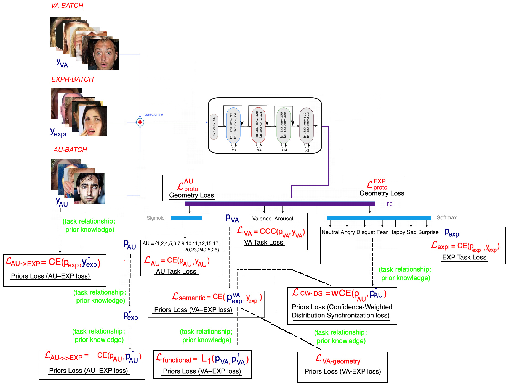

# Behaviour4All: A Dependency-Aware Toolkit for in-the-wild Facial Behaviour Analysis


This repository provides the **official implementation** of our NeurIPS 2026 paper:

> **[Behaviour4All: A Dependency-Aware Toolkit for in-the-wild Facial Behaviour Analysis](#)**  
> **Dimitrios Kollias, Chunchang Shao, Odysseus Kaloidas, Ioannis Patras**


## Overview ✨


Behaviour4All is a dependency-aware Multi-Task Leaning (MTL) framework and toolkit for automatic behaviour analysis. Rather than treating valence-arousal (VA), facial expressions (EXP) and Action Units (AUs) as separate or weakly related outputs, Behaviour4All reformulates MT facial behaviour analysis as a structured dependency-aware optimisation problem.


**Core ideas**:

The framework is built around 3 principled components. Task-specific supervision ensures strong individual performance for VA-E, EXP recognition and AUD. Cross-task dependency modelling encodes structured relations between VA, EXP, AUs via relational priors, enabling learning under heterogeneous and partially overlapping annotations while enforcing semantic consistency across tasks. Geometry modelling shapes the shared representation space so that compatible affective concepts are aligned and incompatible ones are separated, reducing representational conflict and improving cross-db generalisation.

## Toolkit Overview 🖼️



## Method at a Glance 🧠

TBD

## Repository Layout 🗂️

TBD

## Environment ⚙️

TBD

## Data Preparation ⬇️

TBD

## Quick Start 🚀

### Training 🏋️

TBD

### Inference 🔍

TBD

## Citation 📚

```bibtex
TBA
```


